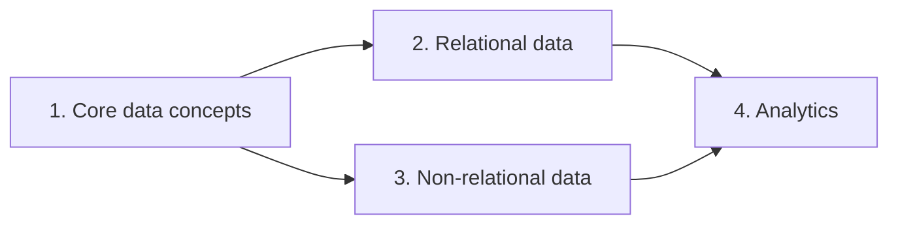

# DP-900: Azure Data Fundamentals

DP-900 is Microsoft's entry-level exam for **data in the cloud**. It checks that you understand the basic ideas — kinds of data, kinds of workloads — and which Azure service fits which job. It is not a prerequisite for anything, but it is a good map before moving on to engineer or analyst certifications.

> I passed DP-900 during the Microsoft AI Data School. This page is my one-page summary of the whole exam, written in my own words. Each section will get its own detailed note later.

## The four skill areas

Based on the skills outline as of July 21, 2026. You need **700 / 1000** to pass.

| # | Skill area | Weight |
| --- | --- | --- |
| 1 | Core data concepts | 25–30% |
| 2 | Relational data on Azure | 20–25% |
| 3 | Non-relational data on Azure | 15–20% |
| 4 | Analytics workloads on Azure | 25–30% |

Areas 1 and 4 together are more than half of the exam.

---

## 1. Core data concepts

<b>Three shapes of data</b>

| Shape | What it looks like | Example |
| --- | --- | --- |
| **Structured** | Fixed columns, every row has the same fields | A table of orders |
| **Semi-structured** | Has structure, but fields can vary | JSON, XML |
| **Unstructured** | No fixed structure | Images, video, PDFs |

<b>Two kinds of workloads: OLTP vs OLAP</b>

| | Transactional (OLTP) | Analytical (OLAP) |
| --- | --- | --- |
| Purpose | Run the business | Understand the business |
| Typical action | Many small reads and writes | Big reads across lots of history |
| Example | "Save this order" | "Sales by month for 3 years" |

<b>Three data roles</b>

- **Database administrator:** keeps databases running, secure and backed up.
- **Data engineer:** builds the pipelines that move and clean data.
- **Data analyst:** turns data into reports and insights.

## 2. Relational data on Azure

<b>Key ideas</b>

- Data lives in **tables** with rows and columns, linked by keys.
- **Normalization** splits data into separate tables so the same fact is not stored twice.
- **SQL** is the language: `SELECT`, `INSERT`, `UPDATE`, `DELETE`, `CREATE TABLE`, and so on.
- Common database objects: tables, views, stored procedures and indexes.

<b>Azure SQL family — which one when?</b>

| Service | In one line |
| --- | --- |
| **Azure SQL Database** | Fully managed database — Azure handles almost everything |
| **Azure SQL Managed Instance** | Near-full SQL Server compatibility, still managed — good for moving existing systems |
| **SQL Server on Azure VM** | You run SQL Server on a VM — most control, most work |

Azure also offers managed services for open-source databases such as **PostgreSQL** and **MySQL**.

## 3. Non-relational data on Azure

<b>Azure Storage options</b>

| Service | Stores | Think of it as |
| --- | --- | --- |
| **Blob Storage** | Files of any kind (images, logs, CSV) | A huge bucket of files |
| **Azure Files** | Shared folders | A network drive in the cloud |
| **Table Storage** | Simple key–value rows | A very cheap, simple NoSQL table |

<b>Azure Cosmos DB</b>

A globally distributed NoSQL database with very fast responses. It offers several **APIs** (ways of talking to it), such as NoSQL, MongoDB, PostgreSQL, Cassandra, Gremlin and Table. Good for apps that need low latency anywhere in the world.

## 4. Analytics workloads on Azure

<b>Large-scale analytics</b>

The usual flow is: **ingest** data → **process** it → **store** it in an analytical store → **analyze and visualize** it. Services named in the exam include **Azure Databricks** and **Microsoft Fabric**.

<b>Batch vs streaming</b>

| | Batch | Streaming |
| --- | --- | --- |
| When | Collected, then processed later | Processed as it arrives |
| Delay | Minutes to hours | Seconds |
| Example | Nightly sales report | Live crowd levels |

My [NowSeoul](../projects/nowseoul.md) project used a streaming pipeline.

<b>Power BI</b>

Microsoft's reporting tool. Know the basics: connecting to data, building a **data model** (tables and relationships), and choosing the right chart for the question.

---

## Source

- [Study guide for Exam DP-900 (Microsoft Learn)](https://learn.microsoft.com/credentials/certifications/resources/study-guides/dp-900)
