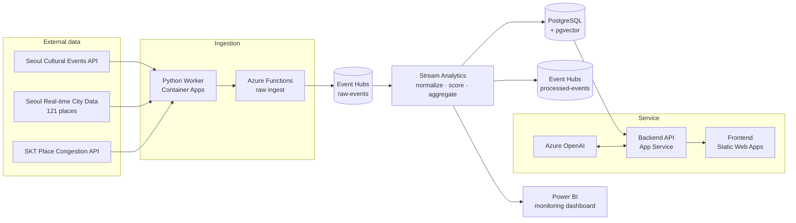

# NowSeoul (지금서울)

**A web service that uses real-time crowd data to recommend the least crowded events and festivals in Seoul, right now.**

| | |
| --- | --- |
| **Period** | Jul 30 – Aug 12, 2026 (2 weeks, from planning to deployment) |
| **Team** | Microsoft AI Data School (5th cohort) mid-course project · 5 members, built to apply as many of the Azure services we had learned as possible |
| **My role** | **Data Engineer** (API integration · real-time pipeline · data preprocessing) + UI/UX |
| **Stack** | Python · Azure Event Hubs · Stream Analytics · Functions · Container Apps · PostgreSQL · Power BI |

### What I did

- **Integrated 4 external APIs**: Seoul cultural events, Seoul real-time city data, TMAP, and the SKT place congestion API, to collect event and crowd data
- **Built the real-time pipeline**: Functions → Event Hubs → Stream Analytics → PostgreSQL / Power BI
- **Designed a common schema**: standardized inconsistent API responses into one JSON format and normalized crowd levels into a 0–100 score and a "leisure score"
- **UI/UX design**: owned the front-end design, polished the user-facing screens in the final stretch, and produced the demo video

### Problems I solved

| Problem | Solution |
| --- | --- |
| Free crowd data only covers 121 busy hotspots | Found each venue's POI with TMAP and filled the gaps with the paid SKT congestion API |
| SKT API daily limit (100 calls) kept running out | Tuned the cache TTL to avoid re-calling the same place and spread calls across the day |
| Event coordinates couldn't be matched to crowd areas | Built the city-data areas as polygons and matched events with a point-in-polygon check |

```text
Event & crowd APIs ─▶ Python Worker / Functions ─▶ Event Hubs ─▶ Stream Analytics ─┬▶ PostgreSQL ─▶ API ─▶ Web
                                                                                   └▶ Power BI (monitoring)
```

🎬 [Demo video](#) · 💻 [GitHub](#) · 📑 [Presentation](#)

---

## Details

<details>
<summary><b>1. Overview: why we built it</b></summary>

Seoul covers about 605 km², roughly one-twentieth the size of Greater Sydney, yet around 9.3 million people live there. Whether you go out for an event or a festival on the weekend, almost everywhere is packed.

**NowSeoul** started from one question: *"Right now, where in Seoul can I enjoy an event without the crowds?"* It's built for people who want to avoid the rush and enjoy the city's culture at their own pace.

This was the mid-course project of the Microsoft AI Data School. Our goal was to put as many of the Azure services we had learned so far (Event Hubs, Stream Analytics, Functions, PostgreSQL, Azure OpenAI, Power BI, and more) into a real, working service.

Existing event services focus on dates and venues; they don't tell you *how crowded a place is right now*. NowSeoul recommends events based on a **leisure score** instead of raw crowd levels.

**Key features**
- 🗺️ Map-based event browsing (color-coded markers by crowd level)
- 🟢 Events ranked by leisure score (least crowded first)
- 🎯 4 personalized recommendation modes (taste, current location, favorite categories, recently viewed)
- 🎙️ RAG-based voice search
- 📊 Power BI operations dashboard

</details>

<details>
<summary><b>2. Data collection: what we collected and how</b></summary>

| Data | Source | Refresh | Purpose |
| --- | --- | --- | --- |
| Cultural events | Seoul Cultural Events API (free) | Daily | Events and festivals currently running in Seoul |
| Real-time crowd levels | Seoul Real-time City Data API (free) | 5 min | Live crowd levels for 121 major places in Seoul |
| Place search | TMAP Place Search | On demand | POI ID and coordinates for each event venue |
| Supplementary crowd levels | SKT Place Congestion API (paid) | 60 min | Crowd levels for places the city data doesn't cover |

1. **Events**: the Seoul Cultural Events API provides the events and festivals currently running in the city.
2. **Real-time crowd levels**: the Seoul Real-time City Data API provides live crowd levels for 121 major places. It's free, but it focuses on busy areas like Gangnam and Hongdae, so many event venues aren't covered.
3. **Filling the gaps**: for places outside the city data, we used the paid SKT Place Congestion API.

For each API, I reviewed the docs and Swagger first, then moved through test calls, repeated collection, validation, and preprocessing. API keys were never hard-coded; they were managed through environment variables and secrets.

</details>

<details>
<summary><b>3. Architecture: Azure resources</b></summary>



| Area | Resources |
| --- | --- |
| Ingestion | Container Apps (Python Worker), Container Registry, Function App |
| Streaming | Event Hubs Namespace, Stream Analytics Job, Storage Account |
| Storage | Azure Database for PostgreSQL (Flexible Server, pgvector) |
| AI | Azure OpenAI (`gpt-4.1-mini`, `text-embedding-3-small`), Speech Service |
| Service | App Service (API), Static Web Apps (frontend) |
| Monitoring | Application Insights, Log Analytics, Power BI |

</details>

<details>
<summary><b>4. Preprocessing: one common format for every API</b></summary>

Each API returned a different structure, so I converted everything into a common JSON envelope. That way, every stage after Event Hubs could **process the data the same way, regardless of which API it came from**.

```text
Raw response → field validation (required · NULL · duplicates · types) → formatting (date parsing · numeric coordinates)
            → code standardization (unified categories · crowd scoring) → common JSON → Event Hubs
```

| Raw value | Transformed |
| --- | --- |
| `AREA_CONGEST_LVL = "약간 붐빔"` (slightly busy) | `congestion_level = BUSY`, `normalized_score = 62.5` |
| `DATE = "2026-08-10~2026-08-15"` | `start_date = 2026-08-10`, `end_date = 2026-08-15` |
| `CODENAME = "전시/미술"` (exhibition/art) | `category_code = EXHIBITION` |

</details>

<details>
<summary><b>5. Stream Analytics: normalizing crowd data and aggregating for monitoring</b></summary>

Raw events arriving in Event Hubs are normalized and sent to two outputs: ① processed-events (then stored in PostgreSQL), and ② 5-minute aggregates for Power BI monitoring.

```sql
-- Convert crowd levels to a 0–100 score (use the numeric score first if it exists)
CASE
    WHEN TRY_CAST(GetRecordPropertyValue(payload, 'normalized_score') AS float) IS NOT NULL
        THEN TRY_CAST(GetRecordPropertyValue(payload, 'normalized_score') AS float)
    WHEN level IN ('여유', 'RELAXED')              THEN 12.5
    WHEN level IN ('보통', 'NORMAL')               THEN 37.5
    WHEN level IN ('약간 붐빔', 'BUSY')            THEN 62.5
    WHEN level IN ('붐빔', 'CROWDED', 'VERY_BUSY') THEN 87.5
END AS crowd_score

-- Standard level and leisure score
CASE WHEN crowd_score < 25 THEN 'RELAXED'
     WHEN crowd_score < 50 THEN 'NORMAL'
     WHEN crowd_score < 75 THEN 'BUSY'
     ELSE 'VERY_BUSY' END   AS standard_level_code,
100.0 - crowd_score         AS leisure_score
```

```sql
-- Power BI monitoring: 5-minute tumbling window per source
SELECT System.Timestamp() AS window_time,
       source_code, event_type,
       COUNT(*)            AS event_count,
       AVG(crowd_score)    AS avg_crowd_score,
       AVG(leisure_score)  AS avg_leisure_score
       -- + counts per level, events per category, missing image/coordinate rates
INTO [nowseoul-powerbi2]
FROM Processed
GROUP BY TumblingWindow(minute, 5), source_code, event_type;
```

The same query also calculates **data quality metrics** such as missing image and missing coordinate rates, which are shown on the dashboard.

</details>

<details>
<summary><b>6. Troubleshooting in detail</b></summary>

**① Crowd data only covered 121 places**
- **Problem**: the free Seoul Real-time City Data API only covers a fixed set of 121 places, so most event venues had no crowd data.
- **Solution**: used TMAP Place Search to get each venue's POI ID and coordinates, then passed them to the SKT Place Congestion API to get live crowd levels for roughly a 350 m × 350 m area around the venue.

**② Hitting the SKT API daily limit**
- **Problem**: the basic plan's limit of 100 calls per day ran out quickly, which stopped data collection.
- **Solution**: tuned the cache TTL to cut repeat calls for the same POI and spread the remaining calls within the daily limit. I also added error handling for each failure case: limit exceeded, unsupported place, and no response.

**③ Matching event coordinates to crowd areas**
- **Problem**: event data only included a venue name and a single coordinate, so it was hard to match events to city-data areas accurately.
- **Solution**: built each city-data place as a polygon and matched events by checking which polygon contains the event's coordinate.

</details>

<details>
<summary><b>7. Features built by teammates (for context)</b></summary>

> These parts were built by my teammates. They're included briefly so the whole service makes sense.

- **Personalized recommendation engine**: applies different weights to the same candidate pool depending on the recommendation goal
  `Score = Σ(weight × signal score) / Σ(weights of available signals) × 100`
- **Taste analysis**: 7 questions → 8-dimensional taste vector → 12 types. Behavioral data (favorites, views) contributes up to 35%
- **RAG voice search**: Web Speech API (STT/TTS) → embeddings and pgvector similarity search → `gpt-4.1-mini` generates the reason for each recommendation
- **Login and personalization**: Google · Naver · Kakao OAuth, favorites, recently viewed, notifications

</details>

<details>
<summary><b>8. Retrospective</b></summary>

**What I learned**
- I built an entire real-time pipeline myself, from collection and normalization to storage, the service, and monitoring.
- Dealing with API limits, caching, and service tiers taught me to choose resources with **cost** in mind.
- I saw firsthand how **standardizing different APIs into a common schema** makes every later stage much simpler.

**What didn't go well, and what I'd do next time**
- The real-time pipeline lacked stability and server resource monitoring, so some features didn't run as planned.
- We didn't review the deployment approach thoroughly early on, so we couldn't follow our initial design.
- **I didn't finish the Power BI features I planned.** We built the operations dashboard, but two features never worked properly by the end of the project:
  - A view showing newly added places and cultural events
  - Alerts when data from a specific API stops coming in
- If I rebuilt it, I'd design this from the start: have Stream Analytics track the last received time per source, and trigger an alert (a Power BI data alert or an Azure Monitor alert) when no new data arrives for a set period.

</details>
