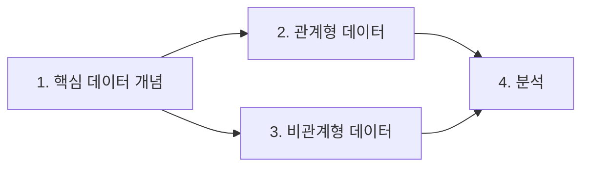

# DP-900: Azure Data Fundamentals

DP-900은 **클라우드 데이터**에 대한 Microsoft의 입문 자격증 시험이에요. 데이터와 워크로드의 종류 같은 기본 개념을 이해하고 있는지, 어떤 일에 어떤 Azure 서비스를 쓰는지 아는지를 확인해요. 다른 자격증의 필수 조건은 아니지만, 엔지니어나 분석가 자격증으로 넘어가기 전에 전체 지도를 잡기에 좋아요.

> Microsoft AI Data School 과정 중에 DP-900을 취득했어요. 이 페이지는 시험 전체를 제 말로 한 장에 정리한 거예요. 영역별 자세한 노트는 하나씩 따로 올릴 예정이에요.

## 4개 출제 영역

2026년 7월 21일 기준 출제 범위예요. 합격 점수는 **700 / 1000점**이에요.

| # | 영역 | 비중 |
| --- | --- | --- |
| 1 | 핵심 데이터 개념 | 25–30% |
| 2 | Azure의 관계형 데이터 | 20–25% |
| 3 | Azure의 비관계형 데이터 | 15–20% |
| 4 | Azure의 분석 워크로드 | 25–30% |

1번과 4번 영역을 합치면 시험의 절반이 넘어요.

---

## 1. 핵심 데이터 개념

<b>데이터의 세 가지 형태</b>

| 형태 | 특징 | 예시 |
| --- | --- | --- |
| **정형 (Structured)** | 열이 정해져 있고, 모든 행이 같은 항목을 가짐 | 주문 테이블 |
| **반정형 (Semi-structured)** | 구조는 있지만 항목이 조금씩 다를 수 있음 | JSON, XML |
| **비정형 (Unstructured)** | 정해진 구조가 없음 | 이미지, 동영상, PDF |

<b>두 가지 워크로드: OLTP vs OLAP</b>

| | 트랜잭션 (OLTP) | 분석 (OLAP) |
| --- | --- | --- |
| 목적 | 업무를 **돌리기** | 업무를 **이해하기** |
| 주된 동작 | 작은 읽기/쓰기를 아주 많이 | 오래된 데이터를 크게 한 번에 읽기 |
| 예시 | "이 주문 저장해 줘" | "3년치 월별 매출 보여줘" |

<b>데이터 직무 세 가지</b>

- **데이터베이스 관리자 (DBA):** DB가 잘 돌아가고 안전하게 백업되도록 관리해요.
- **데이터 엔지니어:** 데이터를 옮기고 정제하는 파이프라인을 만들어요.
- **데이터 분석가:** 데이터를 보고서와 인사이트로 바꿔요.

## 2. Azure의 관계형 데이터

<b>핵심 개념</b>

- 데이터는 행과 열로 된 **테이블**에 저장되고, 키(key)로 서로 연결돼요.
- **정규화**는 같은 정보를 두 번 저장하지 않도록 테이블을 나누는 거예요.
- 사용하는 언어는 **SQL**이에요: `SELECT`, `INSERT`, `UPDATE`, `DELETE`, `CREATE TABLE` 등.
- 자주 쓰는 DB 객체: 테이블, 뷰, 저장 프로시저, 인덱스.

<b>Azure SQL 제품군 — 언제 무엇을?</b>

| 서비스 | 한 줄 요약 |
| --- | --- |
| **Azure SQL Database** | 완전 관리형 DB — 거의 모든 관리를 Azure가 해줌 |
| **Azure SQL Managed Instance** | SQL Server와 거의 똑같이 호환되면서 관리형 — 기존 시스템을 옮길 때 좋음 |
| **SQL Server on Azure VM** | VM 위에 SQL Server를 직접 설치해서 운영 — 자유도는 가장 높지만 관리도 가장 많음 |

**PostgreSQL**, **MySQL** 같은 오픈소스 DB용 관리형 서비스도 있어요.

## 3. Azure의 비관계형 데이터

<b>Azure Storage 종류</b>

| 서비스 | 저장하는 것 | 쉽게 말하면 |
| --- | --- | --- |
| **Blob Storage** | 모든 종류의 파일 (이미지, 로그, CSV) | 거대한 파일 보관함 |
| **Azure Files** | 공유 폴더 | 클라우드에 있는 네트워크 드라이브 |
| **Table Storage** | 단순한 키-값 형태의 행 | 아주 저렴하고 단순한 NoSQL 테이블 |

<b>Azure Cosmos DB</b>

전 세계에 분산되는 NoSQL 데이터베이스로, 응답이 아주 빨라요. NoSQL, MongoDB, PostgreSQL, Cassandra, Gremlin, Table 같은 여러 **API**(접속 방식)를 지원해요. 세계 어디서든 빠른 응답이 필요한 앱에 잘 맞아요.

## 4. Azure의 분석 워크로드

<b>대규모 분석</b>

보통 흐름은 데이터 **수집** → **처리** → 분석용 저장소에 **저장** → **분석과 시각화** 순서예요. 시험에는 **Azure Databricks**와 **Microsoft Fabric**이 나와요.

<b>배치 vs 스트리밍</b>

| | 배치 (Batch) | 스트리밍 (Streaming) |
| --- | --- | --- |
| 처리 시점 | 모아뒀다가 나중에 한꺼번에 | 들어오는 즉시 |
| 지연 | 몇 분 ~ 몇 시간 | 몇 초 |
| 예시 | 매일 밤 만드는 매출 보고서 | 실시간 혼잡도 |

제 [지금서울(NowSeoul)](../projects/nowseoul.md) 프로젝트가 스트리밍 파이프라인을 썼어요.

<b>Power BI</b>

Microsoft의 보고서/대시보드 도구예요. 데이터 연결, **데이터 모델**(테이블과 관계) 만들기, 질문에 맞는 차트 고르기 같은 기본을 알아두면 돼요.

---

## 출처

- [DP-900 시험 학습 가이드 (Microsoft Learn)](https://learn.microsoft.com/credentials/certifications/resources/study-guides/dp-900)
