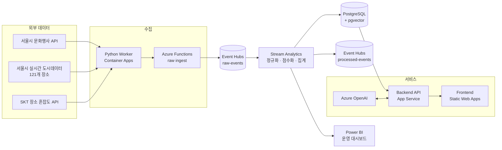

# 지금서울 (NowSeoul)

**실시간 혼잡도 데이터로 "지금 가장 한적한" 서울 행사·축제를 추천하는 웹 서비스**

| | |
| --- | --- |
| **기간** | 2026.07.30 – 08.12 (2주, 기획부터 배포까지) |
| **팀** | Microsoft AI Data School 5기 중간 프로젝트 · 5인 팀 (과정에서 배운 Azure 서비스를 최대한 적용) |
| **역할** | **데이터 엔지니어** (API 연동 · 실시간 파이프라인 · 데이터 전처리) + UI/UX |
| **스택** | Python · Azure Event Hubs · Stream Analytics · Functions · Container Apps · PostgreSQL · Power BI |

### 내가 한 일

- **외부 API 4종 연동**: 서울시 문화행사, 서울시 실시간 도시데이터, TMAP, SKT 혼잡도 API를 붙여 행사·혼잡도 데이터를 수집
- **실시간 파이프라인 구축**: Functions → Event Hubs → Stream Analytics → PostgreSQL / Power BI
- **공통 스키마 설계**: 응답 구조가 제각각인 API를 하나의 JSON 규격으로 표준화하고, 혼잡도를 0–100 점수와 여유도로 정규화
- **UI/UX 디자인**: 프론트 화면 디자인을 맡아 프로젝트 막바지에 사용자 화면을 다듬고, 시연 영상을 제작

### 해결한 문제

| 문제 | 해결 |
| --- | --- |
| 무료 혼잡도 데이터가 번화가 121곳뿐 | TMAP으로 POI를 찾고 SKT 유료 API로 빈 장소를 보완 |
| SKT API 일일 100건 한도 초과 | 캐시 TTL을 조정해 같은 장소 재호출을 줄이고 호출을 한도 안으로 분산 |
| 행사 좌표와 혼잡도 영역 매칭 불가 | 도시데이터 영역을 폴리곤으로 만들어 point-in-polygon 방식으로 매칭 |

```text
행사·혼잡도 API ─▶ Python Worker / Functions ─▶ Event Hubs ─▶ Stream Analytics ─┬▶ PostgreSQL ─▶ API ─▶ 웹
                                                                                 └▶ Power BI (운영 모니터링)
```

🎬 [시연 영상](#) · 💻 [GitHub](#) · 📑 [발표 자료](#)

---

## 자세히 보기

<details>
<summary><b>1. 서비스 개요: 왜 만들었나</b></summary>

서울의 면적은 약 605km²로, 시드니(그레이터 시드니 기준)의 약 20분의 1에 불과합니다. 그런데 이 좁은 땅에 약 930만 명이 살고 있습니다. 주말에 행사나 축제를 즐기러 나가도 어디든 사람으로 붐비기 일쑤입니다.

**지금서울**은 "지금 이 순간, 서울에서 가장 한적하게 즐길 수 있는 곳은 어디일까?"라는 질문에서 시작했습니다. 복잡함을 피해 여유롭게 문화생활을 즐기고 싶은 사람들을 위한 서비스입니다.

Microsoft AI Data School 과정의 중간 프로젝트로, 그때까지 배운 Azure 서비스(Event Hubs, Stream Analytics, Functions, PostgreSQL, Azure OpenAI, Power BI 등)를 실제 서비스에 최대한 적용해 보는 것을 목표로 했습니다.

기존 행사 정보 서비스는 일정과 장소 위주라 *지금 현장이 얼마나 붐비는지*는 알려주지 않습니다. 지금서울은 혼잡도 대신 **여유도(leisure score)** 를 기준으로 행사를 추천합니다.

**주요 기능**
- 🗺️ 지도에서 행사 탐색 (혼잡도 단계별 색상 마커)
- 🟢 여유도가 높은 순으로 행사 추천
- 🎯 개인화 추천 4종 (취향, 현재 위치, 관심 카테고리, 최근 본 행사)
- 🎙️ RAG 기반 음성 검색
- 📊 Power BI 운영 대시보드

</details>

<details>
<summary><b>2. 데이터 수집: 어떤 데이터를 어떻게 모았나</b></summary>

| 데이터 | 출처 | 갱신 주기 | 역할 |
| --- | --- | --- | --- |
| 문화행사 정보 | 서울시 문화행사 정보 API (무료) | 매일 | 지금 서울에서 열리고 있는 행사·축제 목록 |
| 실시간 혼잡도 | 서울시 실시간 도시데이터 API (무료) | 5분 | 서울 주요 121개 장소의 실시간 혼잡도 |
| 장소 검색 | TMAP 장소 통합검색 | 필요 시 | 행사 장소의 POI ID와 좌표 확인 |
| 보완 혼잡도 | SKT 장소 혼잡도 API (유료) | 60분 | 도시데이터가 커버하지 않는 장소의 혼잡도 |

1. **행사 수집**: 서울시 문화행사 정보 API로 현재 서울에서 열리고 있는 행사와 축제 정보를 받아옵니다.
2. **실시간 혼잡도**: 서울시 실시간 도시데이터로 주요 121개 장소의 실시간 혼잡도를 가져옵니다. 무료지만 강남·홍대 같은 번화가 위주라 행사 장소를 모두 커버하지는 못합니다.
3. **빈 곳 보완**: 도시데이터에 없는 장소는 유료인 SKT 장소 혼잡도 API로 채웁니다.

API 문서와 Swagger를 먼저 확인한 다음 호출 테스트, 반복 수집, 검증, 전처리 순서로 진행했습니다. API 키는 코드에 넣지 않고 환경변수와 Secret으로 관리했습니다.

</details>

<details>
<summary><b>3. 아키텍처: Azure 리소스 구성</b></summary>



| 영역 | 리소스 |
| --- | --- |
| 수집 | Container Apps (Python Worker), Container Registry, Function App |
| 스트리밍 | Event Hubs Namespace, Stream Analytics Job, Storage Account |
| 저장 | Azure Database for PostgreSQL (Flexible Server, pgvector) |
| AI | Azure OpenAI (`gpt-4.1-mini`, `text-embedding-3-small`), Speech Service |
| 서비스 | App Service (API), Static Web Apps (프론트) |
| 모니터링 | Application Insights, Log Analytics, Power BI |

</details>

<details>
<summary><b>4. 전처리: 서로 다른 API를 공통 규격으로</b></summary>

API마다 응답 구조가 달라서, Event Hub 이후 단계가 **API 종류와 상관없이 같은 방식으로 처리할 수 있도록** 공통 JSON envelope로 변환했습니다.

```text
원본 응답 → 필드 검증(필수값·NULL·중복·타입) → 형식 정리(날짜 파싱·좌표 숫자형)
        → 코드 표준화(카테고리 통일·혼잡도 점수화) → 공통 JSON → Event Hub
```

| 원본 | 변환 결과 |
| --- | --- |
| `AREA_CONGEST_LVL = "약간 붐빔"` | `congestion_level = BUSY`, `normalized_score = 62.5` |
| `DATE = "2026-08-10~2026-08-15"` | `start_date = 2026-08-10`, `end_date = 2026-08-15` |
| `CODENAME = "전시/미술"` | `category_code = EXHIBITION` |

</details>

<details>
<summary><b>5. Stream Analytics: 혼잡도 정규화와 모니터링 집계</b></summary>

Event Hub로 들어온 raw 이벤트를 정규화한 뒤 두 곳으로 보냅니다. ① processed-events (이후 PostgreSQL로 저장) ② Power BI 모니터링용 5분 단위 집계.

```sql
-- 혼잡도 단계를 0~100 점수로 변환 (숫자 점수가 있으면 그 값을 우선 사용)
CASE
    WHEN TRY_CAST(GetRecordPropertyValue(payload, 'normalized_score') AS float) IS NOT NULL
        THEN TRY_CAST(GetRecordPropertyValue(payload, 'normalized_score') AS float)
    WHEN level IN ('여유', 'RELAXED')              THEN 12.5
    WHEN level IN ('보통', 'NORMAL')               THEN 37.5
    WHEN level IN ('약간 붐빔', 'BUSY')            THEN 62.5
    WHEN level IN ('붐빔', 'CROWDED', 'VERY_BUSY') THEN 87.5
END AS crowd_score

-- 표준 단계와 여유도
CASE WHEN crowd_score < 25 THEN 'RELAXED'
     WHEN crowd_score < 50 THEN 'NORMAL'
     WHEN crowd_score < 75 THEN 'BUSY'
     ELSE 'VERY_BUSY' END   AS standard_level_code,
100.0 - crowd_score         AS leisure_score
```

```sql
-- Power BI 모니터링: 5분 텀블링 윈도우로 소스별 수집량, 평균 혼잡도, 데이터 품질 집계
SELECT System.Timestamp() AS window_time,
       source_code, event_type,
       COUNT(*)            AS event_count,
       AVG(crowd_score)    AS avg_crowd_score,
       AVG(leisure_score)  AS avg_leisure_score
       -- + 단계별 건수, 카테고리별 행사 수, 이미지·좌표 누락률
INTO [nowseoul-powerbi2]
FROM Processed
GROUP BY TumblingWindow(minute, 5), source_code, event_type;
```

이미지·좌표 누락률 같은 **데이터 품질 지표**도 같은 쿼리에서 계산해 대시보드에 띄웠습니다.

</details>

<details>
<summary><b>6. 트러블슈팅 자세히</b></summary>

**① 혼잡도 데이터가 121개 장소뿐**
- **문제**: 무료인 서울시 실시간 도시데이터는 정해진 121곳만 제공해서, 대부분의 행사 장소에는 혼잡도가 없었습니다.
- **해결**: TMAP 장소 통합검색으로 행사 장소의 POI ID와 좌표를 확보한 뒤, SKT 장소 혼잡도 API에 넘겨 장소 중심 약 350×350m 범위의 실시간 혼잡도를 조회했습니다.

**② SKT API 일일 호출 한도 초과**
- **문제**: 베이직 플랜의 일 100건 한도가 금방 소진되어 수집이 멈췄습니다.
- **해결**: 캐시 TTL을 조정해 같은 POI를 다시 호출하는 횟수를 줄이고, 호출을 하루 한도 안으로 분산했습니다. 한도 초과, 미지원 장소, 응답 없음 같은 실패 케이스별 예외 처리도 추가했습니다.

**③ 행사 좌표와 혼잡도 영역 매칭**
- **문제**: 행사 정보에는 장소명과 단일 좌표뿐이라 도시데이터 영역과 정확히 매칭하기 어려웠습니다.
- **해결**: 도시데이터 장소를 폴리곤으로 구성하고, 행사 좌표가 어느 폴리곤 안에 들어가는지로 매칭하도록 바꿨습니다.

</details>

<details>
<summary><b>7. 팀원 담당 기능 (참고)</b></summary>

> 팀원이 구현한 부분이지만, 서비스 전체를 이해하는 데 필요해서 간단히 소개합니다.

- **개인화 추천 엔진**: 같은 후보군에 추천 목적별로 가중치를 다르게 적용
  `Score = Σ(가중치 × 신호 점수) / Σ(사용 가능한 신호 가중치) × 100`
- **취향 분석**: 7문항 → 8차원 취향 벡터 → 12유형. 찜·조회 같은 행동 데이터는 최대 35%까지만 반영
- **RAG 음성 검색**: Web Speech API(STT/TTS) → 임베딩과 pgvector 유사도 검색 → `gpt-4.1-mini`로 추천 이유 생성
- **로그인과 개인화**: Google · Naver · Kakao OAuth, 찜, 최근 본 행사, 알림

</details>

<details>
<summary><b>8. 회고</b></summary>

**배운 점**
- 데이터가 수집, 정규화, 저장을 거쳐 서비스와 모니터링으로 흘러가는 실시간 파이프라인 전체를 직접 구성해 봤습니다.
- API 호출 한도, 캐시 전략, 서비스 티어를 고민하면서 **비용 관점**으로 리소스를 고르는 습관이 생겼습니다.
- 서로 다른 API를 **공통 스키마로 표준화**해 두면 그 이후 단계가 훨씬 단순해진다는 걸 체감했습니다.

**아쉬운 점과 다음에 할 것**
- 실시간 파이프라인의 안정성과 서버 리소스 모니터링이 부족해서, 일부 기능이 계획대로 서비스되지 못했습니다.
- **Power BI로 구현하려던 기능을 끝내지 못했습니다.** 운영 대시보드는 만들었지만, 원래 계획했던 아래 두 가지는 프로젝트 마지막까지 제대로 동작하지 않았습니다.
  - 새로 추가된 장소와 문화행사 정보를 따로 보여주는 화면
  - 특정 API의 데이터가 들어오지 않을 때 바로 알려주는 알림
- 다음에 다시 만든다면, Stream Analytics에서 소스별 마지막 수신 시각을 집계하고 일정 시간 동안 새 데이터가 없으면 알림이 가도록(Power BI 데이터 알림 또는 Azure Monitor 경고) 설계부터 해 두고 싶습니다.
- 배포 방식을 초기에 충분히 검토하지 못해 초반 설계대로 진행하지 못했습니다.
- 다음에는 재시도·중복 방지 정책과 모니터링 알림부터 설계하고 싶습니다.

</details>
